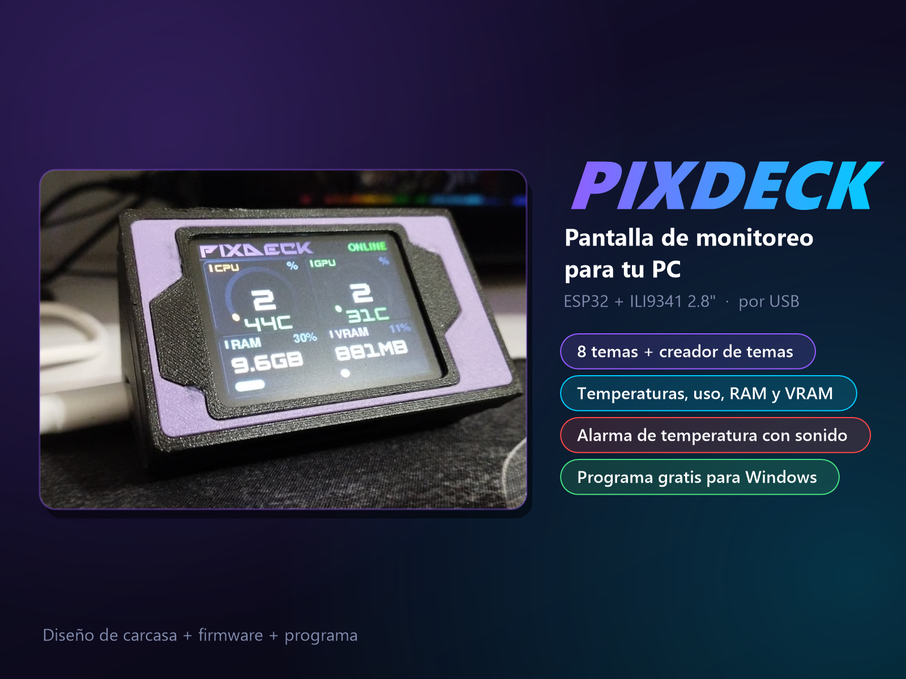
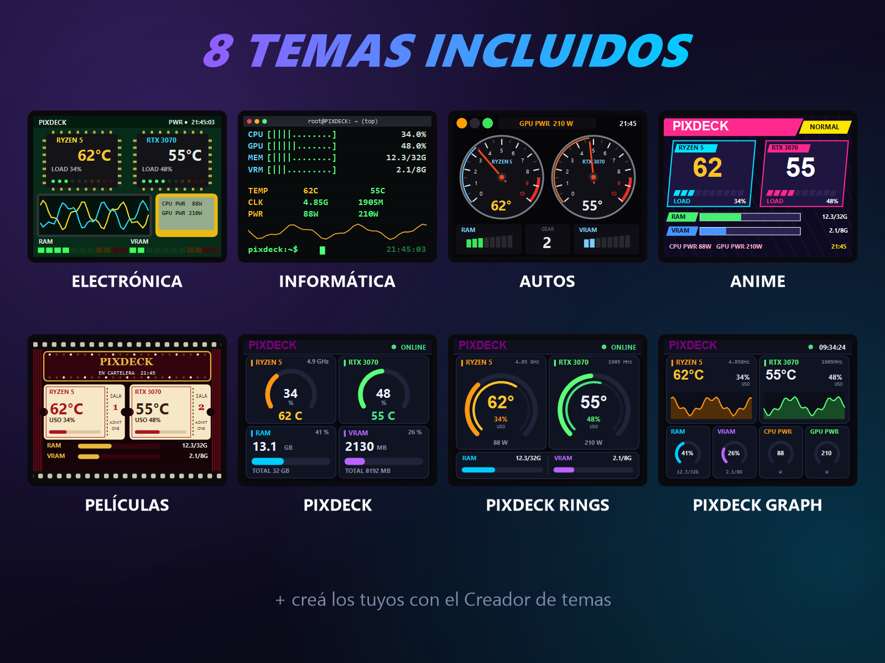
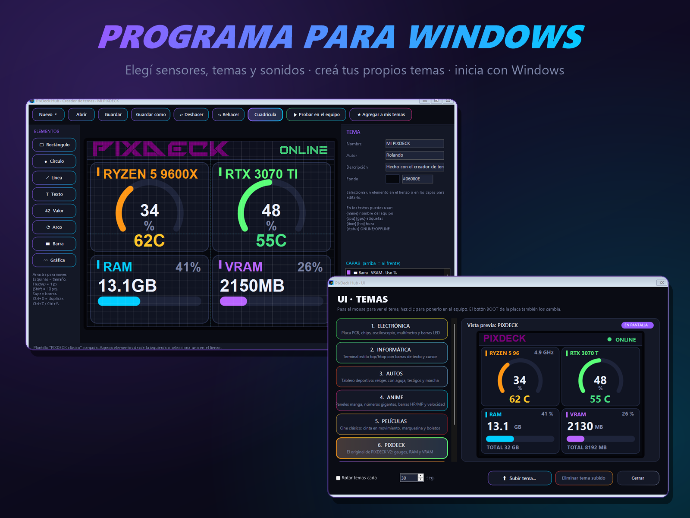

# PIXDECK

**Pantalla de monitoreo para tu PC** — ESP32 + ILI9341 2.8", conectada por USB.
Muestra en tiempo real la temperatura y el uso de CPU y GPU, la RAM y la VRAM, con 8 temas, un creador de temas y alarma de temperatura.

*PC hardware monitor display (ESP32 + ILI9341) with 8 themes, theme editor and temperature alarm. App in Spanish.*

## ⬇️ Descarga

👉 **[Última versión (instalador + firmware)](../../releases/latest)**

- `PixDeckHub_Setup_x.x.x.exe`: el programa para Windows, con instalador.
- `PIXDECK_firmware_x.x.x_ESP32.bin`: el firmware listo para cargar en el ESP32.
- 🖨️ La carcasa para imprimir en 3D está en **[Cults3D](https://cults3d.com/es/modelo-3d/artilugios/pixdeck-pc-hardware-monitor-display)** (gratis, licencia CC BY-NC-SA 4.0).

## ✨ Qué hace

- 8 temas: Electrónica, Informática, Autos, Anime, Películas, PIXDECK, Rings y Graph.
- **Creador de temas**: diseñás tu pantalla, la probás en vivo y la guardás en el equipo.
- Elegís qué sensores mostrar: ventiladores, discos, red, potencias y más.
- **Alarma de temperatura** con sonido (19 sonidos para elegir) y aviso en pantalla.
- Rotación automática de temas. El botón BOOT de la placa también cambia de tema.
- Inicia con Windows en segundo plano.

## 🧰 Materiales

| Pieza | Nota |
|---|---|
| ESP32 DevKit (ESP32-WROOM-32) | con chip USB CP2102 o CH340 |
| Pantalla TFT SPI ILI9341 2.8" (240×320) | sin touch también funciona |
| Buzzer pasivo | opcional, para la alarma |
| Cable USB de **datos** | |

### Conexión

| Pantalla | ESP32 |
|---|---|
| VCC / LED | 3V3 |
| GND | GND |
| CS | GPIO 5 |
| RESET | GPIO 4 |
| DC | GPIO 2 |
| SDI (MOSI) | GPIO 23 |
| SCK | GPIO 18 |
| SDO (MISO) | GPIO 19 |
| Buzzer + | GPIO 25 |

## 🔌 Cargar el firmware

**Opción A: archivo `.bin` (sin programar)**
1. Abrí [ESP Web Tools](https://espressif.github.io/esptool-js/) en Chrome o Edge y conectá el ESP32.
2. Cargá `PIXDECK_firmware_x.x.x_ESP32.bin` en la dirección **0x0** y dale *Program*.

El `.bin` usa exactamente los pines de la tabla de arriba.

**Opción B: IDE de Arduino**
1. Instalá el core **esp32** (3.x) y la librería **TFT_eSPI**.
2. En `TFT_eSPI/User_Setup.h` usá `ILI9341_DRIVER` y los pines de la tabla. Activá `LOAD_GFXFF` y `SMOOTH_FONT`.
3. Abrí `PIXDECK_V3/PIXDECK_V3.ino`, elegí **ESP32 Dev Module** y subilo.

## 💻 Programa para Windows

1. Ejecutá el instalador. Windows o el antivirus pueden avisar porque el programa es nuevo y no está firmado; es normal.
2. Conectá el ESP32 por USB: PixDeck Hub lo encuentra solo.
3. La primera vez elegís los sensores que querés ver.

Requiere Windows 10/11 y [.NET 8 Desktop Runtime](https://dotnet.microsoft.com/download/dotnet/8.0) (si falta, Windows avisa).

Para compilarlo vos: `.\build_installer.ps1` (necesita el .NET 8 SDK).

## 🎨 Temas propios (.pxtheme)

Hacelos con el **Creador de temas** del programa, o a mano en JSON. El formato está explicado en [LEEME.md](LEEME.md#subir-temas-pxtheme). Hay un ejemplo en `temas/`.

## ☕ Apoyá el proyecto

Si te gustó y querés que siga sumando temas y funciones:

- 🇦🇷 Desde Argentina: **[Cafecito](https://cafecito.app/rollin54)**
- 🌎 Desde otros países: **[PayPal](https://www.paypal.com/donate?business=rollin54%40gmail.com&currency_code=USD)**

¡Gracias! 💜

## 📄 Licencia

Código bajo licencia **MIT** (ver [LICENSE](LICENSE)). Las librerías de terceros mantienen sus licencias: ver [THIRD_PARTY.md](THIRD_PARTY.md).
